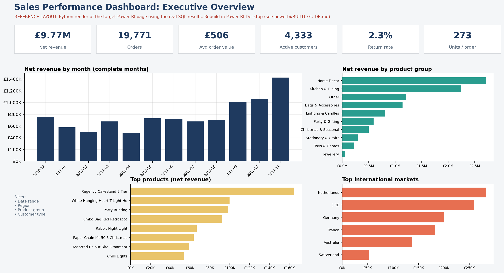
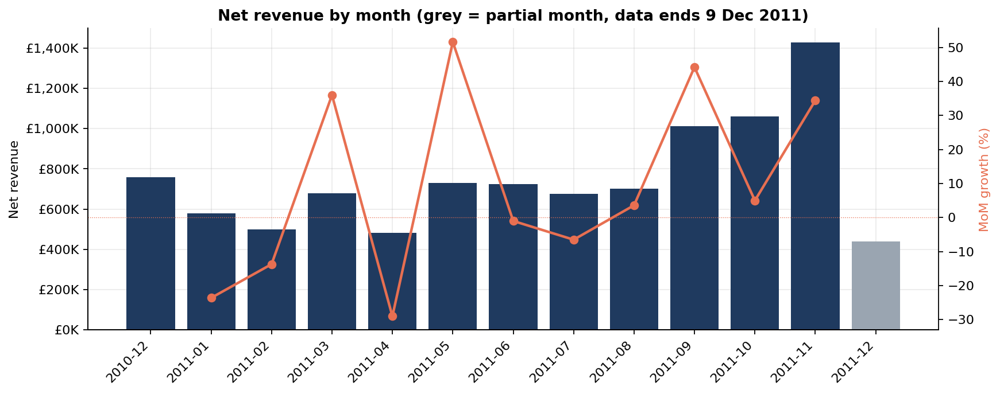
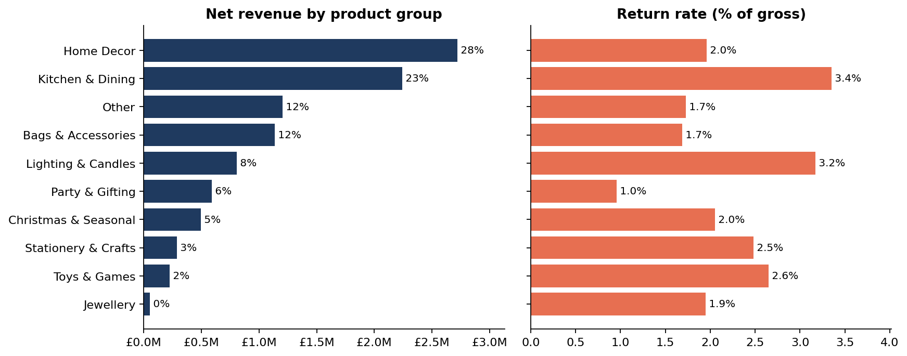

# Sales Performance Dashboard: SQL + Power BI

**SQL (SQLite dialect, window functions, CTEs) · Power BI (star schema, DAX) · Python (pipeline runner, charts)**

An end-to-end sales analytics project on **541,909 real transactions** from a UK online gift retailer (UCI *Online Retail* dataset, Dec 2010 to Dec 2011). Raw data is cleaned and modelled in SQL into a **star schema**, validated with automated data-quality checks, analysed with SQL, and prepared for a **Power BI dashboard** tracking revenue, order volume, product performance and trends.


*Reference layout of the target dashboard page, rendered in Python from the real SQL results. The Power BI file itself is built with `powerbi/BUILD_GUIDE.md` (see "Status" below).*

## Headline results (Dec 2010 - 9 Dec 2011)
| KPI | Value |
|---|---|
| Net revenue | **£9.77M** (gross £10.00M, returns £230K = **2.3%**) |
| Orders | **19,771** |
| Avg order value | **£506** (≈273 units per order) |
| Active registered customers | **4,333** |

*Currency is assumed to be GBP (UK retailer); the source file does not state it.*

## Key insights
1. **Strong Q4 ramp.** Net revenue more than doubled from **£701K (Aug) to £1.43M (Nov, +104%)**; Oct-Nov alone (£2.49M) was the biggest quarter of the year even before December data.
2. **Revenue is concentrated in products.** The top **20% of products generate 78%** of net revenue and the top 10% generate 60%. Best seller: *Regency Cakestand 3 Tier* (£164K net).
3. **Home Decor (28%) and Kitchen & Dining (23%)** lead product groups; Christmas & Seasonal revenue jumps from £126K (Q3) to £284K in Oct-Nov alone.
4. **The UK is 85% of revenue.** The Netherlands (£283K) and Australia (£137K) have very high average order values (£3,053 and £2,466) from few, large orders (93 and 56 orders), an account-management rather than volume story.
5. **A few big orders matter.** Orders over £1,500 are 5% of orders but **36% of revenue**; the top 20% of registered customers drive **74%** of registered-customer revenue.
6. **Loyalty builds through the year.** Returning customers grew from **44% of active customers in Jan to ~74-82% by Jul-Nov**, so retention is working; new customers per month fell from ~400 in Q1 to ~170-240 in summer before recovering to 300+ in autumn.
7. **Trading pattern.** Thursday is the busiest day, there is **no Saturday trading** in the data, and **78% of orders** are placed between 10:00 and 16:00, which is consistent with the retailer's many wholesale customers.
8. **Returns are low overall (2.3%)** but spiky: April 2011 reached 6.5% of gross revenue (a single customer accounts for ~69% of that month's returns).
9. **15% of revenue has no customer ID** (guest checkouts) with over 2x the average order value of registered customers (£1,101 vs £462), a tracking gap worth closing.




## Project structure
```
├── data/raw/online_retail.zip       # source data (UCI Online Retail)
├── sql/
│   ├── 01_staging_and_cleaning.sql  # dedup, typing, classification, exclusion rules, audit log
│   ├── 02_star_schema.sql           # dim_date, dim_product, dim_customer, dim_country, fact_sales
│   ├── 03_data_quality_checks.sql   # 11 automated integrity / reconciliation checks
│   ├── 04_business_analysis.sql     # 16 analysis queries (window functions, CTEs)
│   └── results/*.csv                # query outputs
├── exports/                         # star-schema CSVs for Power BI (+ data_quality_log)
├── powerbi/
│   ├── BUILD_GUIDE.md               # step-by-step build instructions + page specs
│   ├── measures.dax                 # 20+ DAX measures
│   ├── power_query.m                # loaders with typed columns
│   ├── theme.json                   # report theme
│   └── expected_values.md           # numbers to reconcile the report against
├── scripts/                         # build_database.py, run_analysis.py, make_charts.py
├── docs/data_dictionary.md
└── images/
```

## Data model
```
dim_date ─────┐
dim_product ──┤
dim_customer ─┼──< fact_sales   (531,168 invoice lines; sales + returns, revenue signed)
dim_country ──┘
```

## Data cleaning decisions (all logged in `data_quality_log`)
| Step | Rows | Reasoning |
|---|---:|---|
| Raw | 541,909 | |
| Exact duplicates | -5,268 | identical on all 8 columns |
| Non-product codes | -2,986 | postage, fees, manual entries, vouchers are not product sales |
| Zero/negative price | -2,480 | free items and stock write-offs |
| Bad-debt adjustments | -3 | accounting entries |
| **Reversed bulk orders** | -4 | two orders of 74K and 81K units, fully cancelled within 16 min; left in, they inflate gross revenue and push the Jan-11 / Dec-11 return rate to 14% / 28% |
| **Fact rows kept** | **531,168** | sales **and** returns (cancellations), so *Net = Gross - Returns* |

Other modelling choices: guest checkouts (25% of lines, no `CustomerID`) are kept in revenue totals under `customer_key = 0` but excluded from customer counts; **December 2011 is flagged as a partial month** (data ends 9 Dec) and excluded from growth rates; products are grouped by a transparent keyword-rule table (`ref_product_group_rules`) because the source has no category.

## SQL techniques demonstrated
CTEs and recursive CTE (calendar table) · window functions (`LAG`, `SUM() OVER`, `RANK`, `ROW_NUMBER`) · conditional aggregation · Pareto / concentration analysis · cohort logic (new vs returning) · self-joins to detect reversed orders · star-schema design · automated reconciliation checks (row counts, revenue totals, orphan keys, sign rules).

## How to run
```bash
pip install -r requirements.txt
python scripts/build_database.py   # loads raw data, runs SQL 01-03, exports CSVs to exports/
python scripts/run_analysis.py     # runs SQL 04, writes sql/results/*.csv
python scripts/make_charts.py      # writes images/*.png
```
Then follow [`powerbi/BUILD_GUIDE.md`](powerbi/BUILD_GUIDE.md) to build the report. The SQL is SQLite-flavoured but uses standard constructs; date functions (`STRFTIME`, `DATE`, `JULIANDAY`) would need translating for SQL Server / PostgreSQL.

## Status of the Power BI report
The SQL warehouse, data-quality checks, star-schema exports, DAX measures, Power Query loaders, theme, page specifications and a reconciliation sheet are complete. The `.pbix` must be assembled in Power BI Desktop (about 1-2 hours using the guide); when you have built it, save it under `powerbi/`, and add screenshots to this README in place of the reference layout.

## Limitations
- One retailer, 12 months: no year-over-year comparison is possible, and the Q4 peak is a single observation.
- Product groups are heuristic; "Other" is ~12% of net revenue.
- Duplicate-row removal could rarely drop genuine repeat scans (value impact ≈ 0.2%).
- Source: UCI Machine Learning Repository, *Online Retail* (Chen, Sain & Guo, 2012). Please cite it and check its licence when publishing.
